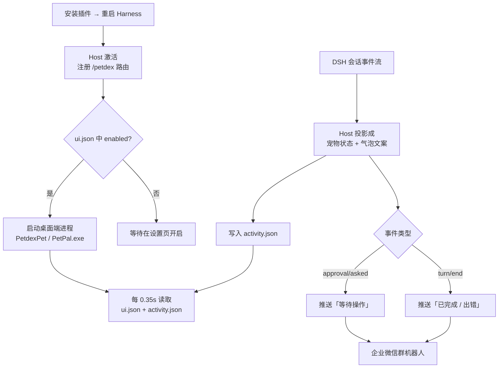
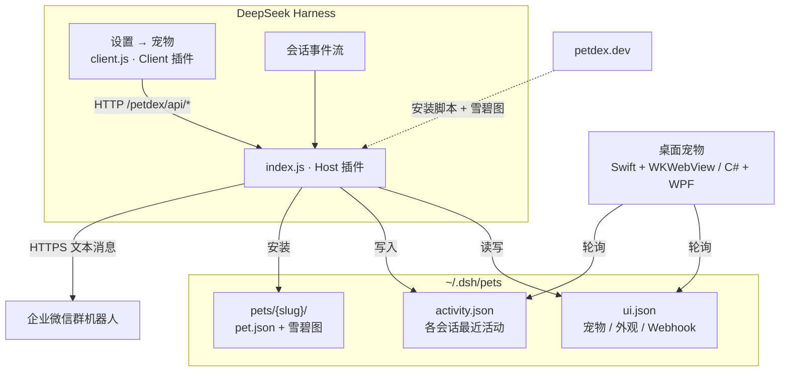
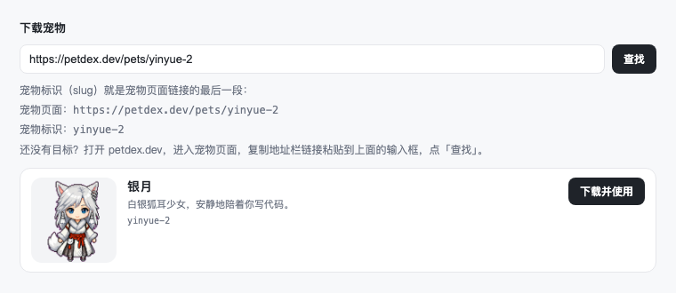
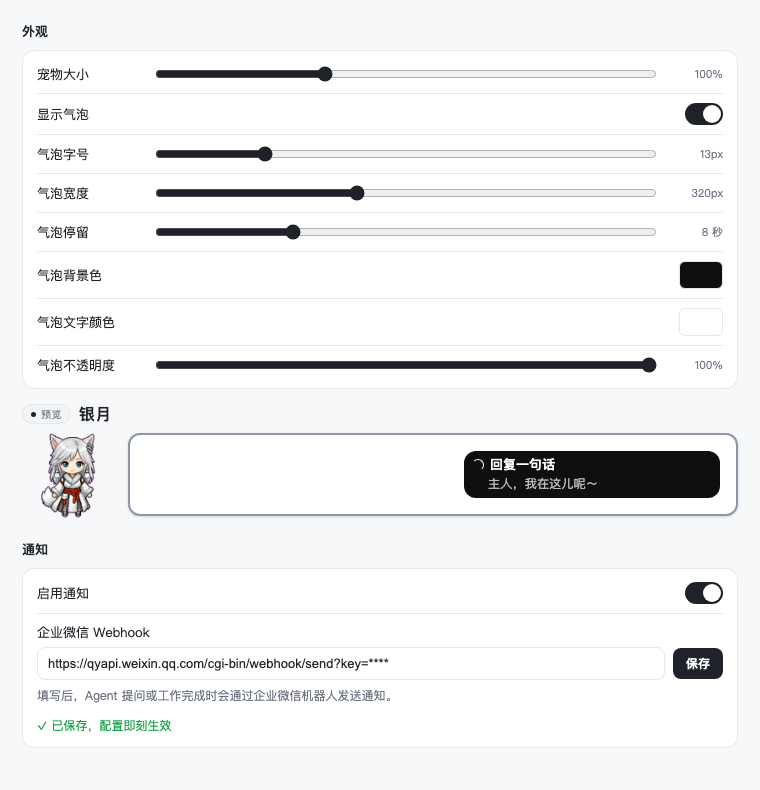
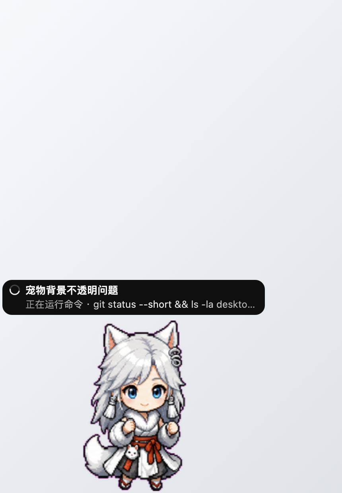

# PetPal · DSH 插件

**给 DeepSeek Harness 养一只桌面宠物，Agent 需要你时用企业微信喊你。**


---

## 项目简介

把 [petdex.dev](https://petdex.dev) 的宠物下载到 DSH 自己的宠物目录，再由**插件自带的原生桌面小应用**把宠物画在桌面上。它会跟着 Agent 的状态动，需要你确认或一轮工作结束时，通过企业微信机器人把消息推到你手机。通过这个插件你在电脑上浏览其他页面或者离开去干别的事时也能简单把握任务进度～

---

## 核心能力

| 能力 | 说明 |
| --- | --- |
| 🐾 宠物库 | 按宠物页面链接或标识（slug）从 petdex.dev 下载，直接落到 `~/.dsh/pets`，可切换、可删除 |
| 🖥️ 桌面常驻 | 原生桌面端（macOS Swift + WKWebView / Windows C# WPF），透明置顶、不抢焦点、不进任务栏 |
| 🎨 外观自定义 | 大小 50–200%、气泡字号/宽度/停留、背景色、文字色、整体不透明度、点击穿透 |
| 💬 会话气泡 | 每个会话一个气泡，实时显示「正在分析请求 / 正在运行命令 / 正在生成回复」，与dsh摘要显示一致，点击可回到 Harness |
| 🎭 状态联动 | 开始任务、工具调用、等待确认、完成任务、任务失败 均能正确映射动作 |
| 📮 主动通知 | Agent 需要确认、一轮工作完成或出错时，通过企业微信机器人推送消息，可一键开关 |
| 🔄 失败自愈 | 设置页加载失败自动退避重试，仍失败则给出「重试」按钮，不会卡在「加载中…」 |
| 🖱️ 宠物交互 | 拖动换位置并写回配置，拖动时按方向播放奔跑动画，点一下会挥手 |
| 📦 跨平台 | 同一套宠物文件在 macOS 与 Windows 通用，桌面端随包分发，无需装 Xcode / .NET SDK |

---

## 核心工作流程



状态来源分两条：**实时流**（`agent/assistant-stream`）负责打字过程中的文案与工具调用，**提交事件**（`session/event`）负责最终的 `turn/end`；另监听 `agent/status` 的 idle 信号，并带 45 秒 / 工具 2 分钟超时兜底，漏事件也不会让宠物一直「运行中」。

---

## 系统架构



桌面端**只读写本地文件**，不联网、不开端口，因此没有常驻后台服务，也不会和 Harness 抢资源：

```
~/.dsh/pets/.petdex/ui.json        active / scale / bubbles / 字号 / 宽度 / 停留 / 穿透 / webhookUrl
~/.dsh/pets/.petdex/activity.json  各会话最近活动 { seq, sessions: [{ id, title, status, label, detail, tokens, hold, rev }] }
~/.dsh/pets/.petdex/app.pid        进程号，插件据此避免重复启动
~/.dsh/pets/.petdex/boot-error.log 插件激活失败时的堆栈（正常为空）
~/.dsh/pets/.petdex/app-error.log  Windows 桌面端自身出错时的堆栈（正常为空）
~/.dsh/pets/.petdex/cache/         Windows 端把 WebP 雪碧图转换后的 PNG 缓存
```

Windows 上 `~/.dsh/pets` 就是 `%USERPROFILE%\.dsh\pets`；窗口位置写进 `ui.json` 的 `winX` / `winY`，与 macOS 的 `x` / `y` 分开保存，不会互相覆盖。

---

## 如何使用

### 1. 安装

需要 DSH 0.2.1+，以及 **macOS 12+** 或 **Windows 10 1903+ / Windows 11**。

```bash
dsh plugin --profile <profile> add github:flowers-59f/dsh-petpal
```

安装后重启 DSH，打开 **设置 → 宠物**。插件市场收录后也可以从 **插件 → 发现** 安装。

> 安装包里已带编译好的桌面端，不需要 Xcode、Swift、.NET SDK 或 Python。

### 2. 下载宠物

打开 [petdex.dev](https://petdex.dev) 找到喜欢的宠物，复制地址栏链接（或链接最后一段的标识），粘贴到「下载宠物」输入框，点「查找」，确认预览后点「下载并使用」。



- 宠物页面：`https://petdex.dev/pets/yinyue-2`
- 宠物标识：`yinyue-2`

已经装过的宠物会显示「使用」或「使用中」，不会重复下载。插件读取 petdex.dev 的安装脚本，把 `pet.json` 和雪碧图写进 `~/.dsh/pets/<slug>` 并切换过去，**不需要安装 Codex**。

> `npx petdex install` 默认装到 `~/.codex/pets`（Codex 的目录），本插件不读取那里。

### 3. 调整宠物设置

同一页面往下就是外观设置：拖动即时生效（桌面端每 0.35 秒读一次配置），顶部「预览」跟着当前宠物、字号、宽度、配色实时变化；再往下是通知设置。



### 4. 获取企业微信 Webhook

1. 创建机器人：企业微信 -> 通讯录 -> 点击最上方的智能机器人 -> 创建 -> 创建一个普通模式的机器人、可见范围勾选上自己，名称简介等其他设置随意
1. 拉群：右上角 “+” 号 -> 发起群聊并勾选上创建的机器人，进入群里中点击右上角 “···” 下滑至消息推送 -> 添加一个消息推送
2. 复制它的 **Webhook 地址**（形如 `https://qyapi.weixin.qq.com/cgi-bin/webhook/send?key=xxxxxxxx`）
3. 回到 **设置 → 宠物 → 通知**，打开「启用通知」，把地址粘进输入框，点「保存」或按回车
4. 出现绿色「✓ 已保存，配置即刻生效」就生效了


之后 Agent 需要你确认、或一轮工作结束时，群里就会收到消息：

```
✅ DeepSeek Harness 通知

会话：<会话标题>
状态：已完成
输出token：xxxx

时间：2026/10/24 09:52:18
```

地址必须以 `https://` 开头，格式不对会标红且无法保存；关掉开关只会暂停发送，**已填的地址会保留**。更多细节与排查见 [docs/wechat-notification.md](docs/wechat-notification.md)。

### 5. 桌面上的样子



- **macOS**：始终置顶、不抢焦点、不占 Dock，出现在所有桌面空间。
- **Windows**：始终置顶、不抢焦点，不出现在任务栏和 Alt+Tab；逐像素透明的分层窗口，支持多显示器与高 DPI。
- 随 Harness 退出：宠物记着父进程 PID，Harness 正常退出或崩溃后 2 秒内自动结束，不留孤儿进程。
- 气泡两行：第一行会话标题，第二行当前动作；多个会话默认只显示最新一个（带 `+N`），点击展开全部。
- 点气泡会激活 DeepSeek Harness（优先走 `dsh://open`）。DSH 目前没有会话级深链，无法直接定位到具体会话。

<details>
<summary>Windows 端补充说明</summary>

- **WebP**：WPF 默认不认 WebP，首次显示某只宠物时会用附带的官方 `dwebp.exe` 转成 PNG 缓存到 `.petdex/cache`，只转一次。
- **虚拟桌面**：Windows 没有让普通窗口固定到所有虚拟桌面的公开接口，宠物留在启动它的那个桌面。
- **独占全屏游戏/视频**：置顶窗口可能被盖住，这是 Windows 的窗口层级限制。
- **未签名 exe**：从压缩包解压运行时可能提示「未知发布者」，选择「仍要运行」即可，或右键属性 → 解除锁定。

</details>

<details>
<summary>构建桌面端 / 卸载</summary>

安装包里已带编译好的桌面端，改了源码后重新构建：

```bash
bash desktop/build.sh            # macOS，需要 swiftc
bash desktop/windows/build.sh    # Windows，需要 .NET SDK 6+，也可交叉构建
```

卸载：设置 → 插件里停用或移除本插件。宠物文件留在 `~/.dsh/pets`；若桌面宠物仍在运行，先在「设置 → 宠物」关掉「桌面宠物」，或结束 `PetdexPet` / `PetPal.exe`。

> 改过 Host `index.js` / Client `client.js` 后需重启一次 Harness（DSH 的 HMR 只热重载 profile 配置），也可以先禁用再启用 `dsh-petpal` bundle 来重载。

</details>

---

## License

MIT © 2026 flowers-59f

桌面端附带的 `dwebp.exe` 来自 WebM Project 的 libwebp，按 BSD 3-Clause 分发，不属于本项目的 MIT 许可；详见 `desktop/windows/THIRD-PARTY-NOTICES.md`。
